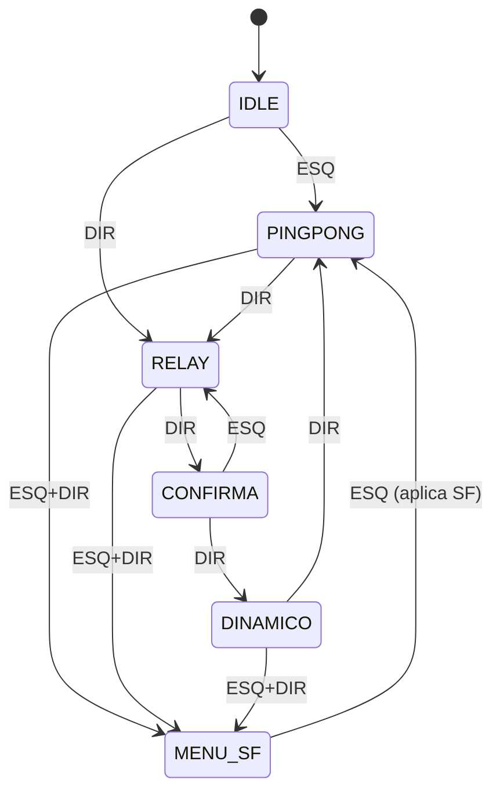
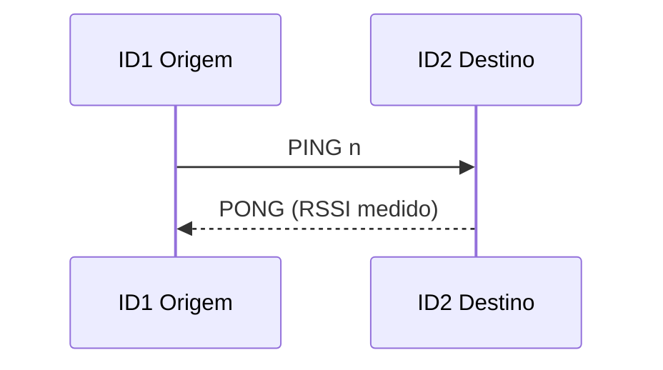
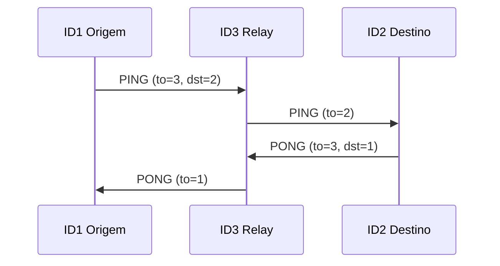
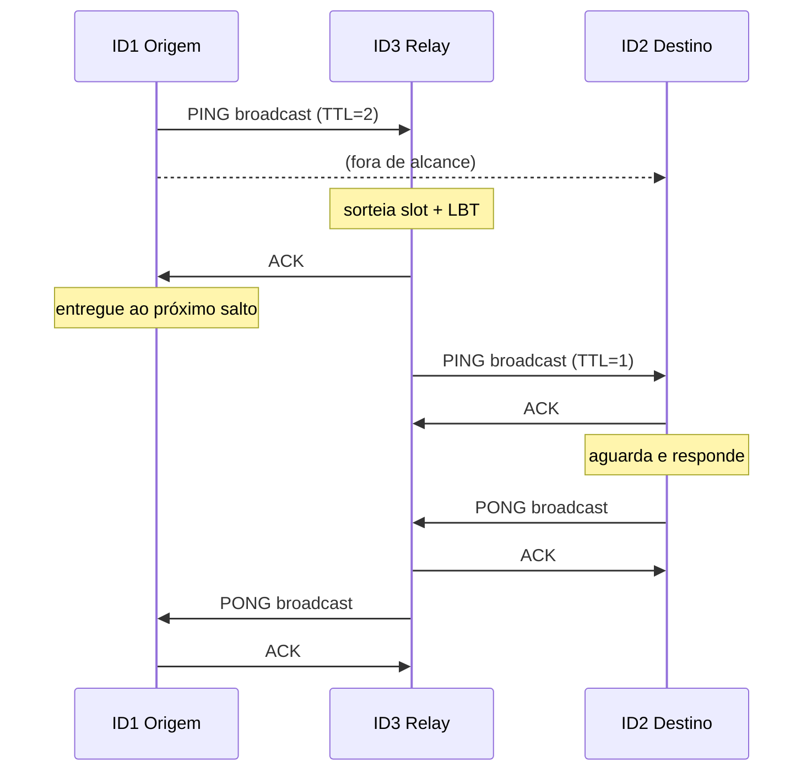

# 📡 LoRa Relay — Ping-Pong, Relay Fixo e Relay Dinâmico

Demonstração prática da tecnologia **LoRa** com três placas **Heltec WiFi LoRa 32 V3** (ESP32-S3 + SX1262).
O mesmo firmware roda nos três rádios e permite, com dois botões, alternar ao vivo entre:

- **Ping-pong direto** entre dois nós;
- **Relay fixo**, onde todo tráfego passa por um nó intermediário;
- **Relay dinâmico**, com broadcast + ACK, backoff aleatório e *listen-before-talk* — a rota é escolhida sozinha;
- **Troca de Spreading Factor (SF7–SF12)** sincronizada em todos os rádios, para ver na prática o compromisso entre alcance e tempo no ar.

O display OLED de cada placa mostra modo, SF, contadores de pacotes, RSSI e SNR em tempo real.

---

## Sumário

- [Hardware](#-hardware)
- [Montagem dos botões](#-montagem-dos-botões)
- [Como gravar](#-como-gravar)
- [Controles](#-controles)
- [Modos de operação](#-modos-de-operação)
- [Protocolo](#-protocolo)
- [Parâmetros de rádio](#-parâmetros-de-rádio)
- [Tempo no ar por SF](#-tempo-no-ar-por-sf)
- [Saída serial](#-saída-serial)
- [Licença](#-licença)

---

## 🔧 Hardware

| Qtd | Item |
|---|---|
| 3 | Heltec WiFi LoRa 32 **V3** (ESP32-S3 + SX1262, OLED 128×64) |
| 3 | Antena 915 MHz (**nunca** transmita sem antena) |
| 2 | Botões táteis (só no nó ID 1) |
| 2 | Resistores de 10 kΩ (pull-down) |

| ID | Papel | Função |
|:-:|---|---|
| **1** | Origem | Tem os botões, gera os PINGs e comanda os modos |
| **2** | Destino | Responde cada PING com um PONG |
| **3** | Relay | Repassa pacotes entre 1 e 2 |

## 🔌 Montagem dos botões

Apenas no nó **ID 1**. Cada botão usa um resistor de pull-down externo de 10 kΩ:

```
3V3 ───[botão]───┬─── GPIO 6 (ESQ) / GPIO 7 (DIR)
                 │
               [10k]
                 │
                GND
```

Botão solto = `LOW`, pressionado = `HIGH`.

## 🚀 Como gravar

1. No Arduino IDE, adicione o pacote de placas da Heltec em **Preferências → URLs adicionais**:
   ```
   https://resource.heltec.cn/download/package_heltec_esp32_index.json
   ```
2. Em **Gerenciador de Placas**, instale **Heltec ESP32 Series Dev-boards**.
3. Selecione a placa **WiFi LoRa 32(V3)**.
4. Abra `LoRa_Relay/LoRa_Relay.ino` e ajuste o ID **antes de gravar cada placa**:
   ```cpp
   #define NODE_ID 1   // 1 = origem, 2 = destino, 3 = relay
   ```
5. Grave as três placas (uma com cada ID) e abra o Monitor Serial a **115200 baud** se quiser acompanhar os logs.

> ⚠️ O código usa **915 MHz**, faixa permitida no Brasil (e nas Américas). Para usar em outra região, altere `RF_FREQUENCY`.

## 🎮 Controles

Todos os comandos são feitos no nó **ID 1**. O evento é disparado ao **soltar** o botão.

| Botão | Situação | Ação |
|---|---|---|
| **ESQ** | parado | Inicia o ping-pong |
| **ESQ** | rodando | Pausa / retoma o tráfego |
| **DIR** | ping-pong | Ativa o modo **RELAY** (envia 3 avisos) |
| **DIR** | relay | Pede confirmação no display → **DIR** confirma modo **DINÂMICO** |
| **DIR** | dinâmico | Volta ao ping-pong direto |
| **ESQ + DIR** | qualquer | Abre o menu de SF: **DIR** troca opção, **ESQ** confirma, **ESQ+DIR** cancela |



## 🔁 Modos de operação

### 1. Ping-pong direto

O nó 1 envia `PING n` para o nó 2, que espera 200 ms e responde `PONG` com o RSSI que mediu. Sem PONG dentro do timeout, o PING é contado como perdido.



### 2. Relay fixo

Todo pacote é endereçado (unicast) ao nó 3, que troca o campo `to` e repassa ao destino final. Útil para mostrar como um salto extra estende o alcance quando 1 e 2 não se escutam.



### 3. Relay dinâmico (broadcast + ACK)

Aqui ninguém sabe a rota de antemão. O pacote vai em **broadcast** com `TTL = 2`, e quem o recebe agenda um **ACK num slot aleatório** (6 slots). Antes de transmitir o ACK, o nó escuta o canal (**LBT**): se o RSSI estiver acima de −85 dBm, adia mais um slot (até 3 vezes).

- O **primeiro ACK** ouvido **cancela** os ACKs pendentes dos outros nós (supressão), evitando colisões.
- Se quem confirmou **não é o destino**, ele assume a responsabilidade de **repassar** o pacote (com `TTL − 1`) e passa a esperar o próprio ACK.
- Se a origem não recebe ACK, retransmite até **3 vezes**.
- Um cache dos últimos 16 pacotes descarta duplicados.

Resultado: se o destino está ao alcance, a entrega é direta; se não está, o relay assume automaticamente.



### 4. Troca de SF sincronizada

O nó 1 envia o novo SF em broadcast **5 vezes** (redundância). Cada aviso carrega quantas repetições ainda faltam (`aux`), então os nós 2 e 3 calculam quando a última vai terminar e trocam de SF **todos juntos**, sem precisar de ACK. Depois todos voltam ao ping-pong direto.

## 📦 Protocolo

Cada pacote tem um cabeçalho fixo de **10 bytes** seguido de até **20 bytes** de texto.

| Byte | Campo | Descrição |
|:-:|---|---|
| 0 | `magic` | `0xA5` — descarta pacotes de outras redes |
| 1 | `type` | `1` PING · `2` PONG · `3` MODO · `4` SF · `5` ACK |
| 2 | `src` | Origem do pacote |
| 3 | `dst` | Destino final |
| 4 | `from` | Quem transmitiu este salto |
| 5 | `to` | Próximo salto (`0xFF` = broadcast) |
| 6 | `seq` | Número de sequência |
| 7 | `ttl` | Saltos restantes (modo dinâmico) |
| 8 | `arg` | MODO: novo modo · SF: novo SF · ACK: `src` confirmado |
| 9 | `aux` | MODO/SF: repetições restantes · ACK: tipo confirmado |
| 10+ | `data` | Texto (`"PING 12"`, `"PONG rssi -87"`, ...) |

A separação entre **`src`/`dst`** (fim a fim) e **`from`/`to`** (salto a salto) é o que permite o mesmo formato servir aos três modos.

## 📻 Parâmetros de rádio

| Parâmetro | Valor |
|---|---|
| Frequência | 915 MHz |
| Potência | 14 dBm |
| Largura de banda | 125 kHz |
| Spreading Factor | SF7 (padrão) até SF12 |
| Coding Rate | 4/5 |
| Preâmbulo | 8 símbolos |
| Cabeçalho / CRC | explícito / ligado |

Os tempos de espera (timeouts, slots de ACK, intervalo entre avisos) são **calculados a partir do tempo no ar** do SF atual, então o protocolo continua funcionando ao trocar de SF7 para SF12.

## ⏱️ Tempo no ar por SF

Calculado pela mesma fórmula usada no firmware (BW 125 kHz, CR 4/5, cabeçalho explícito, CRC):

| SF | ACK (13 bytes) | Pacote cheio (30 bytes) |
|:-:|:-:|:-:|
| 7 | 46 ms | 72 ms |
| 8 | 82 ms | 123 ms |
| 9 | 165 ms | 226 ms |
| 10 | 289 ms | 453 ms |
| 11 | 578 ms | 905 ms |
| 12 | 1155 ms | 1647 ms |

Cada passo de SF praticamente **dobra** o tempo no ar em troca de mais sensibilidade (≈ 2,5 dB por passo) — é exatamente isso que o menu de SF permite observar ao vivo no RSSI, no SNR e na taxa de perdas.

## 🖥️ Saída serial

Exemplo de log no nó relay durante o modo dinâmico:

```
[MODO] -> DINAMICO
[RX] PING src=1 dst=2 from=1 to=255 seq=42 "PING 17" RSSI=-71 SNR=9
[ACK] enviando para ID1 (slot 2)
[TX] ACK src=3 dst=1 to=1 seq=42 "ACK"
[TX] PING src=1 dst=2 to=255 seq=42 "PING 17"
[RX] ACK src=2 dst=3 from=2 to=3 seq=42 "ACK" RSSI=-64 SNR=10
[ACK] recebido de ID2
```

## 🙏 Créditos

Baseado no exemplo **pingpong** da biblioteca da Heltec, expandido com relay fixo, relay dinâmico e troca de SF.

Desenvolvido por **Viktor Miranda** — Engenharia de Telecomunicações, FT/UNICAMP.

## 📄 Licença

Distribuído sob a licença MIT. Veja [LICENSE](LICENSE).
